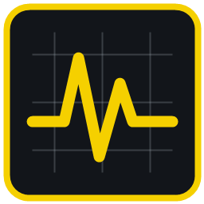
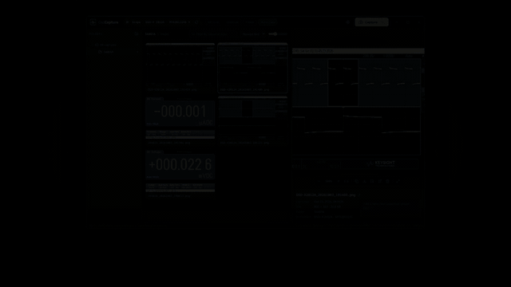
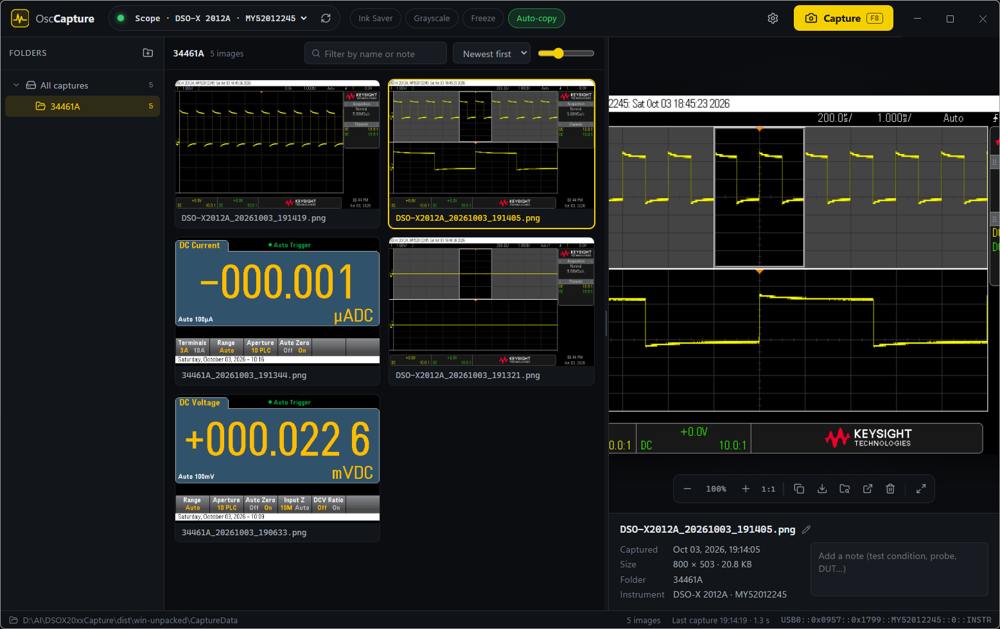

<div align="center">



# OscCapture

**One-click screen capture and image library for your bench instruments.**

Grab the screen of a Keysight InfiniiVision oscilloscope over USB, file every capture automatically,<br>
and do the same for multimeters and power supplies — all from one Windows app.

DSOX 오실로스코프(USB), 34401A(시리얼), 34461A(USB), 전원공급기(SCPI 지원 장비), DL3021(시리얼)<br>
장비들의 화면을 캡처할 수 있습니다.


[Download](../../releases/latest) · [Features](#features) · [Supported instruments](#supported-instruments) · [Getting started](#getting-started) · [Build from source](#build-from-source)

</div>

<p align="center"><a href="../../releases/latest"></a></p>



## Why

Saving scope screenshots usually means a USB stick, a vendor web page, or a remote-control tool — and then renaming and sorting files by hand. OscCapture turns that into one keystroke: the image lands in a named, dated file in the right folder, and it is already on your clipboard for your report or chat.

## Features

**Capture**
- One click on **Capture**, or a hotkey (default **F8**). The hotkey can be made **global**, so it works while you are in another window.
- **Ink Saver** (white background), **Grayscale**, **Freeze** (stop → capture → resume) and **Auto-copy** to the clipboard.
- File names from a template: `{model}`, `{serial}`, `{date}`, `{time}` — e.g. `DSO-X2012A_20261003_191405.png`.

**Library**
- Folder tree with counts, an optional subfolder per instrument model, and drag-to-move.
- Thumbnail grid with adjustable size, filter by file name or note, sort by date or name.
- Rename, move, delete to the Recycle Bin, and a **note on every capture** (test condition, probe, DUT…).

**Viewer**
- Zoom and 1:1, full-window view, copy, Save As, show in Explorer, open in your default image app.

**More than oscilloscopes**
- Truevolt multimeters return a real screen dump.
- The 34401A and power supplies have no screen dump, so OscCapture reads them over SCPI and draws a clean display image — optionally with the instrument front panel. Several RS-232 instruments can be connected at once, each on its own COM port.

## Supported instruments

| Type | Models | Connection | Capture |
|---|---|---|---|
| Oscilloscope | InfiniiVision DSO/MSO-X 2000, 3000, 4000 X-Series | USB | Screen dump (PNG) |
| Multimeter | 34460A, 34461A, 34465A, 34470A | USB | Screen dump (PNG) |
| Multimeter | 34401A | RS-232 | Reading drawn by the app |
| Power supply | Rigol DP800, Siglent SPD3303X / SPD1000X, Keysight/Agilent E36xx, Multicomp Pro MP7100 / OWON, any SCPI unit | USB or RS-232 | Reading drawn by the app |

Tested with a DSO-X 2012A, a 34461A and a 34401A. Other models in these families should work; reports are welcome in [Issues](../../issues).

## Getting started

### Requirements
- Windows 10 or 11, 64-bit
- [Keysight IO Libraries Suite](https://www.keysight.com/find/iosuite) for USB instruments (it provides VISA). Check that your instrument appears in **Keysight Connection Expert**.
- For RS-232 instruments: a serial port or a USB-serial adapter.

### Install
1. Download `OscCapture-vX.Y.Z-win-x64.zip` from [Releases](../../releases/latest).
2. Unzip it anywhere, e.g. `C:\Tools\OscCapture`.
3. Run `OscCapture.exe`.

> Windows may show a SmartScreen warning because the app is not code-signed. Click **More info → Run anyway**.

No installer, no registry entries: captures go to `CaptureData` and settings to `configOscCapture.json`, both next to the exe. Copy the folder to move everything.

### First capture
1. Connect the scope by USB and start OscCapture. It scans for instruments at startup; use ⟳ to rescan.
2. Pick the instrument in the top bar, then press **Capture** or **F8**.
3. The capture appears at the top of the grid and, with Auto-copy on, is ready to paste.

### RS-232 instruments (34401A, power supplies)
Open **Settings → Serial instruments**, add a COM port and baud rate, then rescan.
For the 34401A, set the meter to 9600 baud, 8N1. For each port you can choose **display only** or **display with the instrument body**.

### Keyboard

| Key | Action |
|---|---|
| F8 (configurable) | Capture |
| ← → ↑ ↓ / Home / End | Move through captures |
| Enter / Esc | Toggle full view / exit full view or clear selection |
| Ctrl+C | Copy image |
| Ctrl+A | Select all |
| F2 | Rename |
| Del | Delete to the Recycle Bin |

### Custom power supply profiles
In **Settings**, click **Edit psuProfiles.json**. The file is created next to the exe with an example entry; add the SCPI commands of your unit and click refresh. No rebuild needed.

## Troubleshooting

| Problem | What to check |
|---|---|
| No instrument found | Is it listed in Keysight Connection Expert? Close other apps that hold the instrument open, then rescan. |
| 34401A does not answer | Baud rate and 8N1 on both sides; null-modem cable; DTR is enabled by the app. |
| Hotkey does not work | Another app may own the key. Pick a different one in Settings. |

## Build from source

Requires Node.js 22 LTS or newer.

```bash
npm install
npm run dev        # run with hot reload
npm run typecheck
npm run build:win  # builds dist/win-unpacked, keeping existing CaptureData and settings
```

Project layout: `src/main` (Electron main process: VISA, serial, instrument drivers, library), `src/preload`, `src/renderer` (React UI and the DMM/PSU display renderers), `src/shared` (types).

## License

[MIT](LICENSE) © utotech

Keysight, Agilent, InfiniiVision and Truevolt are trademarks of Keysight Technologies. Rigol, Siglent, OWON and Multicomp Pro are trademarks of their respective owners. This project is independent and is not affiliated with or endorsed by any of them.
